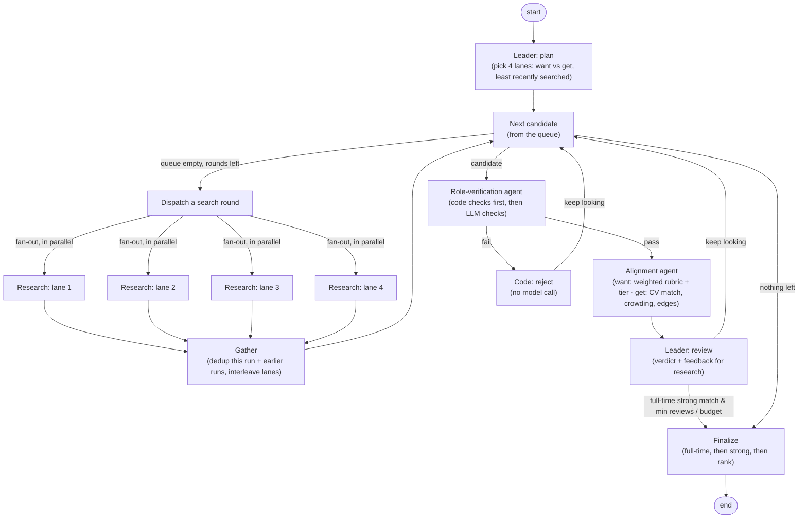

# Agentic Job Matcher

A small multi-agent system that searches the web for **real, recent roles** (London first, then major US cities) across up to 11 career lanes, and ranks those a graduate candidate both **wants** (it fits their thesis about where the job market is going) and can **get** (it fits their CV and plays to their edges). Each run, a leader agent picks the 4 most promising lanes and searches them **in parallel**; a memory across runs skips roles already reviewed. Results come in two tiers, *strong match* and *worth applying*, with next steps: the apply link, the deadline, warnings to confirm, what to lead with and which gaps to address.

The search result isn't the point. The project shows an **explainable agentic workflow**: a leader agent and three specialist sub-agents, wired as an explicit graph with a feedback loop, typed hand-offs, code-enforced guardrails, a full trace and an end-to-end eval.

> The candidate profile in this repo is **anonymised** ("Candidate A"; employers and institutions are pseudonyms such
> as "VenueCo"). The example runs were produced from the real profile and then anonymised the same way.

See [DESIGN_NOTES.md](DESIGN_NOTES.md) for the design Q&A, the engineering lessons from real runs, and results.

## Architecture



`python -m matcher graph` prints the graph that LangGraph actually compiled.

| Agent | Job | Output contract |
|---|---|---|
| **Leader** (`agents/leader.py`) | Writes the search brief; reviews each candidate; sends feedback that steers the next research round | `SearchBrief`, `LeaderReview` → `Decision` |
| **Leader** chooses lanes | From 11 lanes in `thesis.yaml` (hedge funds, asset management, PE and secondaries, wealth management, exchanges, frontier infrastructure, fintech AI, research, corporate venture, market data, energy and commodities), picks 4 per run balancing want and get, preferring lanes not searched recently; code enforces valid ids and the count | `SearchBrief` with `LanePlan`s |
| **Research** (`agents/research.py`) | **Live (default):** one focused web search per chosen lane, run in parallel (LangGraph `Send` fan-out), each returning up to 3 postings with posting date (or recency clue), seat type and role type; results are gathered into a queue. Round 2 widens to off-cycle internships only if no full-time role has been accepted. **Files:** chooses from saved postings instead | `PostingBatch` of `JobPosting` (`CandidateChoice` in files mode) |
| **Role verification** (`agents/verification.py`) | Hard eligibility in **code** first: employer not excluded, still open (warns if closing within 14 days), posted within 30 days (undated postings pass with a warning), role type, start timing, experience, graduation year, application link, location (London; major US cities at a higher bar), and excluded employers. Only then the **LLM**: genuinely entry-level, open to a graduating candidate, a real named vacancy | `VerificationResult` |
| **Alignment** (`agents/alignment.py`) | **Want:** scores six thesis dimensions 0–5 with evidence. **Get:** marks each requirement met/partial/missing against CV evidence, judges how crowded the intake is, and how strongly the role rewards the candidate's edges. Weights, adjustments, totals and labels are computed in code | `AlignmentResult` |

### Design choices

- **Graph, not one big prompt.** Each agent has one narrow job and its own model, so each can be tested, priced and debugged separately. Routing is plain Python over typed state (`graph.py`).
- **Loop with a stop condition.** The leader's feedback accumulates in state and is shown to the research agent on every round. The loop ends when a posting is accepted *and* at least `min_reviews` postings have been compared, or when `max_iterations` is reached.
- **Cheap checks before expensive ones.** Code checks run first; a role that fails them is rejected by code, with no model verification, scoring or leader review spent on it. Web research runs once per shortlist, not once per candidate, and each fetched page is capped in size.
- **Preferences as code, not prompts.** Learning and early responsibility are weighted 1.5x in the rubric. Two tiers: *strong match* at 22/30 and *worth applying* at 19/30 (US cities +1). Rank weights want and get equally, then adjusts: postings from the last 7 days +2 (14 days +1), roles rewarding the candidate's edges up to +3, crowded intakes -2, seats outside investing/analysis or client-facing -2, US cities outside Eastern time -1; a start before the candidate's availability costs 2 desirability points. Every adjustment is shown in the report.
- **Fan-out and gather.** Each search round sends one research task per lane with LangGraph's `Send`; they run in parallel and a gather step merges, deduplicates and interleaves their results, so reviews alternate lanes.
- **Resumable runs.** LangGraph's SQLite checkpointer saves state after every step (`runs/<id>/checkpoint.sqlite`). If a run stops (network drop, API error), `python -m matcher resume` continues from the last completed step; in a parallel search round, lanes that finished are kept and only failed ones re-run.
- **Memory across runs.** `runs/history.json` records every role reviewed and when each lane was last searched, so weekly runs skip roles already seen (listed in the report with the earlier verdict) and the leader rotates through lanes.
- **Full-time first, strong first.** Only a full-time strong match ends the search early; the final pick prefers full-time, then strong, then rank.
- **One clock.** Every agent is told the run date; without it a model falls back on its own idea of today and disagrees with the code checks.
- **Code-enforced guardrails.** Three gates (verified, wanted, attainable) are computed deterministically. They are a **veto, not a mandate**: the leader can reject a posting that passes every gate, but it cannot accept one that fails a gate.
- **Structured outputs everywhere.** Every hand-off is a Pydantic model sent to Claude as a JSON schema, so outputs are validated, not parsed from prose.
- **Mixed models.** Leader on Opus (few calls, highest-stakes judgement), web research and alignment on Sonnet, extraction and verification on Haiku. All configurable in `config/settings.yaml`. Cost estimates include web-search fees ($10 per 1,000 searches).
- **Explainability.** Each run writes `runs/<id>/report.md` (decision, next steps, every iteration's reasons) and `runs/<id>/trace.jsonl` (every node step and model call, with tokens, cost and latency). See [`runs/live-example/report.md`](runs/live-example/report.md) for a real search and [`runs/practice-example/report.md`](runs/practice-example/report.md) for the practice set.
- **No fabrication.** If the research agent can't open a posting page, it reports leads instead of inventing a record. An empty round uses up an iteration rather than ending the run.

## Quick start

```bash
python -m venv .venv && source .venv/bin/activate
pip install -e ".[dev]"

pytest -q                                  # offline tests: rules, scoring, routing, orchestration (free)
python -m matcher graph                    # print the compiled graph
python -m matcher check                    # test the API key and credit (a fraction of a cent)
python -m matcher resume                   # continue the latest run that stopped part-way (or: resume RUN_ID)
python -m matcher run --lanes 1            # cheap test: one lane, one round (check the web search works)
python -m matcher run --target 20          # one-off volume run: 20 actionable roles across all lanes, cost cap $20

# Option A: Anthropic API (pay per token)
cp .env.example .env                       # add ANTHROPIC_API_KEY
python -m matcher run                      # real postings via web search (add --no-history to ignore earlier runs)

# Option B: your Claude plan, via the Claude Code CLI (`claude` must be installed and logged in)
python -m matcher run --backend claude_cli

# Saved postings instead of web search (e.g. the practice set, or your own folder of saved postings)
python -m matcher run --source files --postings-dir postings/practice --today 2026-10-11

# End-to-end eval on the practice set: every posting must be caught by the agent it was designed to test
pytest -m live                              # or: MATCHER_BACKEND=claude_cli pytest -m live
```

## Inputs

- `config/profile.yaml`: what the candidate can **get**: skills with CV evidence, known gaps, **edges** (what sets them apart), home and secondary locations, and the date they are available from.
- `config/thesis.yaml`: what the candidate **wants**: the market thesis, the 11 **lanes**, preferred seat types, excluded lanes and employers, the six-factor rubric with its **weights** and tier thresholds, and the **preferences** (penalties and bonuses) applied in code.
- `config/settings.yaml`: models per agent, lanes per run, review and search-round budgets, the 30-day posting cap, web limits and the history file.
- `postings/practice/`: seven **fictional** postings with known right answers. They are the test harness for the eval, not the product (see `postings/README.md`).

## Layout

```
src/matcher/
  graph.py         LangGraph state machine and routing
  agents/          leader, research, verification, alignment
  schemas.py       typed contracts between agents
  rules.py         deterministic checks, weighted scoring, tiers, adjustments and gates
  history.py       memory across runs (roles reviewed, lanes searched)
  checkpoint.py    saved progress for resumable runs
  llm.py           API and Claude-CLI backends, cost estimate
  trace.py         JSONL tracer
  report.py        Markdown run report
tests/             offline unit + orchestration tests (stand-in agents) and a live end-to-end eval
```

## Stack

Python 3.10+, [LangGraph](https://github.com/langchain-ai/langgraph) (orchestration), [Anthropic Python SDK](https://github.com/anthropics/anthropic-sdk-python) (Messages API, structured outputs, server-side web search), Claude Code CLI (alternative backend), Pydantic, pytest.
