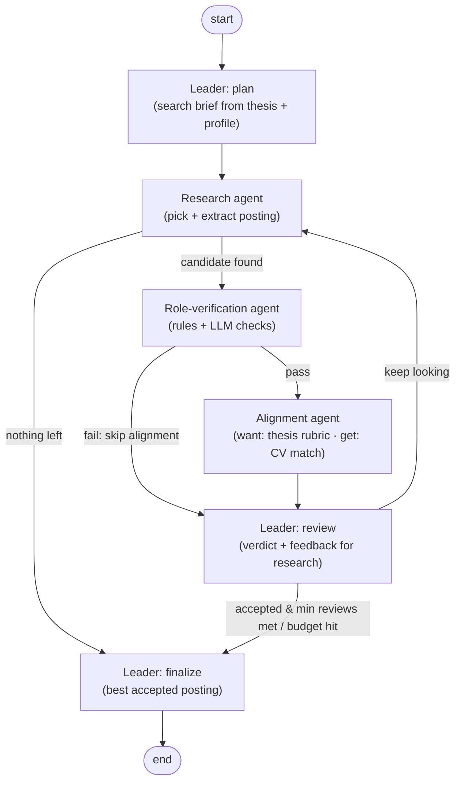

# Agentic Job Matcher

A small multi-agent system that searches the web for **real, open job postings** and picks the one a graduate candidate both **wants** (it fits their thesis about where the job market is going) and can **get** (it fits their CV). It finishes with next steps: the apply link, the deadline, what to lead with and which gaps to address.

The search result isn't the point. The project shows an **explainable agentic workflow**: a leader agent and three specialist sub-agents, wired as an explicit graph with a feedback loop, typed hand-offs, code-enforced guardrails, a full trace and an end-to-end eval.

> The candidate profile in this repo is **anonymised** ("Candidate A"; employers and institutions are pseudonyms such
> as "VenueCo"). The example runs were produced from the real profile and then anonymised the same way.

See [DESIGN_NOTES.md](DESIGN_NOTES.md) for the design Q&A, the bugs the evals caught, and results from real runs.

## Architecture



`python -m matcher graph` prints the graph that LangGraph actually compiled.

| Agent | Job | Output contract |
|---|---|---|
| **Leader** (`agents/leader.py`) | Writes the search brief; reviews each candidate; sends feedback that steers the next research round | `SearchBrief`, `LeaderReview` → `Decision` |
| **Research** (`agents/research.py`) | **Live (default):** web-searches for a real open posting matching the brief and feedback, opens the page, then extracts a structured record. **Files:** chooses from saved postings instead | `JobPosting` (`CandidateChoice` in files mode) |
| **Role verification** (`agents/verification.py`) | Hard eligibility in **code** (still open, years of experience, graduation year, location, has an application link); judgement calls by the **LLM** (genuinely entry-level, full-time path, a real named vacancy) | `VerificationResult` |
| **Alignment** (`agents/alignment.py`) | **Want:** scores the six thesis dimensions 0–5, each with evidence. **Get:** marks each requirement met/partial/missing against named CV evidence. Totals and labels are computed in code | `AlignmentResult` |

### Design choices

- **Graph, not one big prompt.** Each agent has one narrow job and its own model, so each can be tested, priced and debugged separately. Routing is plain Python over typed state (`graph.py`).
- **Loop with a stop condition.** The leader's feedback accumulates in state and is shown to the research agent on every round. The loop ends when a posting is accepted *and* at least `min_reviews` postings have been compared, or when `max_iterations` is reached.
- **Short-circuit.** If verification fails, alignment is skipped, which is cheaper and gives a clearer explanation.
- **Code-enforced guardrails.** Three gates (verified, wanted, attainable) are computed deterministically. They are a **veto, not a mandate**: the leader can reject a posting that passes every gate, but it cannot accept one that fails a gate.
- **Structured outputs everywhere.** Every hand-off is a Pydantic model sent to Claude as a JSON schema, so outputs are validated, not parsed from prose.
- **Mixed models.** Leader on Opus, judgement-heavy alignment on Sonnet, high-volume extraction and verification on Haiku. All configurable in `config/settings.yaml`.
- **Explainability.** Each run writes `runs/<id>/report.md` (decision, next steps, every iteration's reasons) and `runs/<id>/trace.jsonl` (every node step and model call, with tokens, cost and latency). See [`runs/live-example/report.md`](runs/live-example/report.md) for a real search and [`runs/practice-example/report.md`](runs/practice-example/report.md) for the practice set.
- **No fabrication.** If the research agent can't open a posting page, it reports leads instead of inventing a record. An empty round uses up an iteration rather than ending the run.

## Quick start

```bash
python -m venv .venv && source .venv/bin/activate
pip install -e ".[dev]"

pytest -q                                  # offline tests: rules, scoring, routing (free)
python -m matcher graph                    # print the compiled graph

# Option A: Anthropic API (pay per token)
cp .env.example .env                       # add ANTHROPIC_API_KEY
python -m matcher run                      # real postings via web search

# Option B: your Claude plan, via the Claude Code CLI (`claude` must be installed and logged in)
python -m matcher run --backend claude_cli

# Saved postings instead of web search (e.g. the practice set, or your own folder of saved postings)
python -m matcher run --source files --postings-dir postings/practice

# End-to-end eval on the practice set: every posting must be caught by the agent it was designed to test
pytest -m live                              # or: MATCHER_BACKEND=claude_cli pytest -m live
```

## Inputs

- `config/profile.yaml`: what the candidate can **get**: skills, each with a short evidence line from the CV, plus known gaps.
- `config/thesis.yaml`: what the candidate **wants**: the market thesis, the preferred and excluded lanes, and the six-factor rubric with its 22/30 threshold.
- `postings/practice/`: four **fictional** postings with known right answers. They are the test harness for the eval, not the product (see `postings/README.md`).

## Layout

```
src/matcher/
  graph.py         LangGraph state machine and routing
  agents/          leader, research, verification, alignment
  schemas.py       typed contracts between agents
  rules.py         deterministic checks, scoring and gates
  llm.py           API and Claude-CLI backends, cost estimate
  trace.py         JSONL tracer
  report.py        Markdown run report
tests/             offline unit tests + live end-to-end eval
```

## Stack

Python 3.10+, [LangGraph](https://github.com/langchain-ai/langgraph) (orchestration), [Anthropic Python SDK](https://github.com/anthropics/anthropic-sdk-python) (Messages API, structured outputs, server-side web search), Claude Code CLI (alternative backend), Pydantic, pytest.
