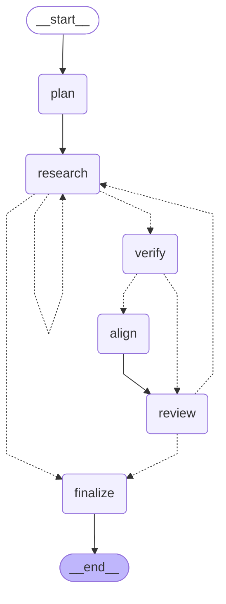

# Run report `20261012-033202`

- **Backend:** api  |  **Source:** live
- **Models:** leader=claude-opus-5-5, research=claude-haiku-5-5, research_live=claude-sonnet-5-5, verification=claude-haiku-5-5, alignment=claude-sonnet-5-5
- **Stopped because:** iteration budget reached (4)
- **Model calls:** 23  |  **Tokens:** 1,041,740 in / 35,346 out  |  **Est. cost:** $2.4155

## Result

No posting passed all three gates within the budget.

## Leader's search brief

- **Target roles:** 2027 Graduate Analyst - Markets (Rates, FX, Credit trading or sales) at a top bank, London or New York; 2027 Graduate Analyst - Electronic Trading / E-Commerce / Digital Markets desk (e.g., e-FX, e-Rates, credit e-trading, market making support); 2027 Graduate Analyst - Markets Strats / Desk Strategist (non-C++ track, Python-light acceptable), rates/FX/credit; 2027 Graduate Analyst - Market Structure / Product / Business Development at financial-market infrastructure firms (VenueCo, MarketAxess, LSEG/FX venues, CME/BrokerTec, ICE, Bloomberg Fixed Income, Euronext, Cboe, LCH); 2027 Analyst - Event-driven / special situations / macro fund graduate program (selective); 2027 Analyst - Restructuring advisory (only as fallback within IB)
- **Must-haves:** Entry-level graduate/analyst role for 2027 start (graduation June 2027), 0 years experience required; Located in London or New York (candidate holds US and UK citizenship, no sponsorship needed); Seat sits on or directly beside a trading/markets desk or venue product: rates, FX, credit, e-trading, market structure; Junior makes or directly informs repeated decisions with feedback (pricing, quoting, client flow, product/fee decisions), not pure analysis production; Builds systems knowledge of how markets work (liquidity, protocols, electronification, D2C/D2D, market microstructure); AI/automation complements the role: data, tooling, applied LLM or quant workflows valued; Client/counterparty or senior-stakeholder exposure building relationship capital; Credible path to P&L, risk, book, or product ownership; Skills transferable to a New York seat (US Treasuries, USD rates, global FX, US credit preferred); Applications open now or still accepting (as of Oct 2026) for 2027 graduate intake
- **Red flags:** Private banking, wealth management, UHNW advisory roles; Generalist private equity or private credit analyst programs; Long-only benchmarked asset management roles; Conventional M&A/ECM/DCM IB, consulting, corporate finance, FP&A or generic middle/back office (operations, KYC, compliance) roles; Roles requiring production C++ or formal quant research PhD-level experience; Roles requiring 1+ years experience or experienced hires/lateral; Pure reporting or deck-production roles with no decision rights; Locations outside London or New York; Internship-only postings (summer 2027) rather than full-time 2027 graduate analyst roles, unless they convert directly; Application deadlines already passed

## Iterations

| # | Posting | Verified | Wanted | Attainable | Verdict |
|---|---|---|---|---|---|
| 1 | BNP Paribas Corporate & Institutional Banking, Global Markets: London - 2027 Global Markets Graduate Analyst - Trading (reference UKECGMGraduate01) | pass | **FAIL** | pass | REJECT |
| 2 | BNP Paribas Corporate & Institutional Banking, Global Markets: 2027 Global Markets Graduate Analyst - Structuring | **FAIL** | not run | not run | REJECT |
| 3 | Citi, Markets: Markets – Sales and Trading, Full Time Analyst, London – United Kingdom, 2027 | pass | **FAIL** | pass | REJECT |
| 4 | BNP Paribas Corporate & Institutional Banking, Global Markets, Automated Market Making (AMM) desk: London – Graduate Associate Programme 2027 – Automated Market Making ETF | pass | pass | **FAIL** | REJECT |

### Iteration 1: BNP Paribas Corporate & Institutional Banking, Global Markets, London - 2027 Global Markets Graduate Analyst - Trading (reference UKECGMGraduate01)

**Leader:** The posting is verified: it is open on a rolling basis, it is entry-level, it is eligible for 2027 graduates and it is full-time. Attainability is HIGH at 78%. However, desirability scored 20, below the thesis threshold of 22, so the wanted gate fails. Every dimension except learning density and US portability scored only 3, largely because the desk and asset class are unstated, there is no described progression or P&L path, and much of the work is research and commentary that AI can compress. It sits in a preferred lane (bank Markets), but the generic, unspecified trading seat does not clear the bar.

**Feedback to research:** Target bank Markets or market-infrastructure postings that name the desk (rates, FX, credit, e-trading or strats) and describe direct execution, pricing or automation responsibilities. The ideal posting also mentions rotation or a NY/US mobility path, so that decision_rights, ai_complementarity and ownership_path can score 4 or higher. Prioritise e-trading or strats roles where Python and quant work is central, given the candidate's VenueCo market-structure background.

Desirability 20/30; attainability 78%.

### Iteration 2: BNP Paribas Corporate & Institutional Banking, Global Markets, 2027 Global Markets Graduate Analyst - Structuring

**Leader:** Verification failed on graduation year: the page lists eligibility as 2026 graduates only, and the candidate graduates in 2027. The summary flags this as possibly a stale template, but it was not confirmed. Alignment scoring was skipped, so the posting has no thesis score. The research agent's own notes also call it a weak fit: generic structuring with no named rates, FX, credit or e-trading desk, and Python is not required. All gates came out false, so it cannot be accepted.

**Feedback to research:** Before submitting, confirm graduation-year eligibility on the live application portal (e.g. the bwelcome jobId page). Prioritise named rates, FX, credit or e-trading desk seats, or market-infrastructure firms, whose 2027 cohort explicitly accepts 2027 graduates. Spend the limited tool budget on fully verifying one strong lead rather than on partial checks of several.

### Iteration 3: Citi, Markets, Markets – Sales and Trading, Full Time Analyst, London – United Kingdom, 2027

**Leader:** Verification passed and attainability is MEDIUM (60%). The lane fits: a Citi Markets FICC/equities S&T programme sits in the preferred bank Markets lane. However, desirability scored 20 against the threshold of 22, so the wanted gate fails. The scorer marked down decision_rights (2) because the work is support, data-gathering and shadowing, and gave only middling scores to AI complementarity, relationship capital and ownership path. There are also open doubts: the body text references a Summer 2026 start despite the 2027 title, and open status was not verified live.

**Feedback to research:** Look for postings with explicit desk-level decision rights rather than generic rotational graduate schemes, such as e-trading, rates/FX strats or market-making analyst roles where the junior prices, quotes or runs algos with feedback. Confirm live open status and the start year from the posting body before scoring.

Desirability 20/30; attainability 60%.

### Iteration 4: BNP Paribas Corporate & Institutional Banking, Global Markets, Automated Market Making (AMM) desk, London – Graduate Associate Programme 2027 – Automated Market Making ETF

**Leader:** The posting is verified and wanted: it is a real 2027 graduate programme on BNP Paribas's AMM ETF desk, and it scores exactly 22, meeting the threshold squarely within the e-trading lane. However, it fails attainability at 36% (LOW). The posting requires a Master's degree (>4 years of study) and high OOP Python proficiency, and the profile shows a 3-year BSc and Python still being built with no shipped production code. Those are hard-requirement misses, not stretch gaps, so applying would likely waste the candidate's single graduate-programme application at BNP that academic year.

**Feedback to research:** Keep targeting e-trading and bank Markets seats, but screen out roles that require an MSc/PhD or production Python. Prioritise bachelor's-eligible graduate programmes in rates/FX/credit trading, e-trading sales or market-structure roles, where the candidate's VenueCo, markets-structure and maths credentials meet the core requirements.

Desirability 22/30; attainability 36%.

## Graph

Full step-by-step evidence (every check, score and model output) is in `trace.jsonl`.
