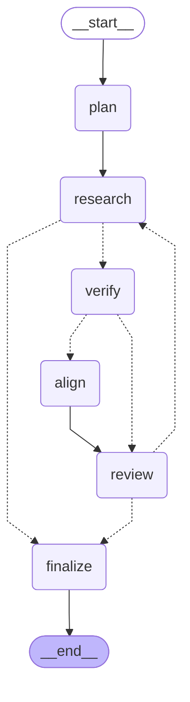

# Run report `practice-example` (run 20261011-221720)

- **Backend:** claude_cli  |  **Source:** fixtures
- **Models:** leader=claude-opus-5-5, research=claude-haiku-5-5, verification=claude-haiku-5-5, alignment=claude-sonnet-5-5
- **Stopped because:** accepted candidate found after 3 reviews
- **Model calls:** 17  |  **Tokens:** 706,156 in / 14,975 out  |  **Est. cost:** $0.3964

## Result

**Graduate Analyst, Electronic Rates & Market Structure (London)**, Meridian Clearing & Markets (London, UK)

Desirability 24/30, attainability 100%.

> I'm accepting this posting because it passes all three gates. Verified: all seven checks passed. Applications close 2026-11-15 and today is 2026-10-11, the programme is open to 2027 graduates with no experience required, and it is a full-time programme with a named Rates product team and concrete duties. Wanted: I re-added the dimension scores (4+5+4+4+4+3) and they total 24, above the 22 threshold. The role sits in the preferred lane (electronic rates and market structure at a venue) and the posting backs this up: the analyst presents to the product committee from year one and can own a product line within three years. Attainable: all five requirements are met (100%), mostly through the candidate's VenueCo work on Treasury fee capture and market structure, which matches the pricing and fee strategy rotation. The candidate also holds UK citizenship, and Python is only listed as a plus.

## Leader's search brief

- **Target roles:** 2027 Graduate Analyst – Markets (Rates, FX, Credit trading or e-trading/electronic market making), London or New York; 2027 Graduate Analyst – Markets Strats / Desk Strategist (rates, FX, credit; non-C++ strats tracks); Graduate / Analyst – Electronic Trading or Market Structure at market-infrastructure firms (VenueCo, MarketAxess, LSEG/FXall, CME/BrokerTec, ICE, Bloomberg, Euronext/MTS, Cboe); Graduate Product Analyst / Business Analyst – fixed income or FX trading venues (product ownership track); 2027 Graduate Analyst – Event-driven / special situations / macro investing (hedge fund or bank principal desk); 2027 Graduate Analyst – Restructuring advisory (only as a fallback within IB); Graduate Analyst – Digital/energy infrastructure principal investing (selective, only with direct deal decision exposure)
- **Must-haves:** Start date in summer/autumn 2027 (graduate/new-analyst programme or full-time direct hire); open to candidates graduating June 2027 with 0 years' experience; Located in London or New York (or a London programme with a stated NY rotation or mobility); Seat sits on or right next to a trading/market-making/investing decision: pricing, risk, flow, execution, venue product or principal capital. Not just producing materials; Covers rates, FX, credit, e-trading, market structure or event/macro investing; Technical tooling is valued (Python/SQL/automation/LLM/data) but not required as production-level C++ or quant research; Posting is live and accepting applications as of Oct 2026 (2027 graduate cycle), with an application link and deadline if stated; No visa sponsorship needed: candidate holds US and UK citizenship, so roles in either location are fine
- **Red flags:** Private banking, wealth management, UHNW advisory or client-advisory associate roles; Generalist private equity, private credit/direct lending, or benchmarked long-only asset management; Conventional M&A/ECM/DCM coverage IB, management consulting, corporate finance/FP&A or Big-4 roles; Back/middle-office operations, reconciliations, KYC/onboarding or controls roles with no path to the desk; Quant researcher/developer roles that need C++, a PhD or shipped production code; Requires 1+ years' experience, or is an internship/off-cycle placement rather than a full-time graduate start; Locations other than London/NY with no mobility, or postings that are expired or closed; Sales-only roles with no product or market depth, or pure 'data entry' analyst titles

## Iterations

| # | Posting | Verified | Wanted | Attainable | Verdict |
|---|---|---|---|---|---|
| 1 | Meridian Clearing & Markets: Graduate Analyst, Electronic Rates & Market Structure (London) | pass | pass | pass | ACCEPT |
| 2 | Vantage Quantitative Trading: Junior Quantitative Researcher, Rates Market Making (London) | pass | pass | **FAIL** | REJECT |
| 3 | Northgate Capital Partners: Analyst, Direct Lending (New York) | **FAIL** | not run | not run | REJECT |

### Iteration 1: Meridian Clearing & Markets, Graduate Analyst, Electronic Rates & Market Structure (London)

**Leader:** I'm accepting this posting because it passes all three gates. Verified: all seven checks passed. Applications close 2026-11-15 and today is 2026-10-11, the programme is open to 2027 graduates with no experience required, and it is a full-time programme with a named Rates product team and concrete duties. Wanted: I re-added the dimension scores (4+5+4+4+4+3) and they total 24, above the 22 threshold. The role sits in the preferred lane (electronic rates and market structure at a venue) and the posting backs this up: the analyst presents to the product committee from year one and can own a product line within three years. Attainable: all five requirements are met (100%), mostly through the candidate's VenueCo work on Treasury fee capture and market structure, which matches the pricing and fee strategy rotation. The candidate also holds UK citizenship, and Python is only listed as a plus.

**Feedback to research:** Two dimensions held this posting back: US portability (3) and the fact that this is a venue product seat rather than a trading seat. Next time, favour postings that name a New York office or transfer route, or bank e-trading and strats seats where the junior has risk or P&L decision rights. When a posting is ambiguous, check how much weight junior recommendations actually carry, for example whether committee decisions are reported back to the analyst who made the recommendation.

Desirability 24/30; attainability 100%.

### Iteration 2: Vantage Quantitative Trading, Junior Quantitative Researcher, Rates Market Making (London)

**Leader:** The posting passed verification. It is a full-time, permanent role open to 2027 graduates, with rolling applications and a London location. It is also wanted: it scores 23 against a threshold of 22 and sits in the preferred electronic rates market-making lane. The problem is attainability, which alignment puts at 12% (LOW). Three of the four requirements are missing outright: a PhD, production-quality C++ and Python, and deep knowledge of stochastic calculus and time-series econometrics. The fourth, published research or competitive programming, is only partly met through national maths olympiad. The candidate is a a leading European university BSc Economics & Finance student, so the PhD gap is a hard degree-level barrier that strong maths grades cannot make up for.

**Feedback to research:** Keep targeting electronic rates and FX markets, but screen out postings that require a PhD, deep stochastic calculus or production C++. Look instead for undergraduate graduate-programme seats such as bank Markets e-trading analyst, desk strats, trading analyst at a market maker, or market-structure roles at exchanges and venues. These should accept a BSc in Economics or Finance, value the candidate's maths and market-structure knowledge, and treat Python as something to build on the job rather than a requirement on day one.

Desirability 23/30; attainability 12%.

### Iteration 3: Northgate Capital Partners, Analyst, Direct Lending (New York)

**Leader:** This posting fails all three gates. It is not verified because the closing date (2026-09-30) passed before today (2026-10-11). It is not attainable because it asks for "2+ years of investment banking or leveraged finance experience" and the candidate has none, so the entry_level and experience checks both failed. It is also not wanted: middle-market direct lending is private credit, which the thesis excludes as a cycle bet, and the seat is mostly memo writing and covenant monitoring rather than repeated market decisions.

**Feedback to research:** Before scoring a posting, drop any with a past closing date or min_years_experience > 0, and drop private credit, direct lending and other excluded lanes. Look instead for 2027 graduate or analyst programmes in bank Markets (rates, FX, credit, e-trading, strats) or at market-infrastructure firms in London or New York.

## Graph

Full step-by-step evidence (every check, score and model output) is in `trace.jsonl`.
