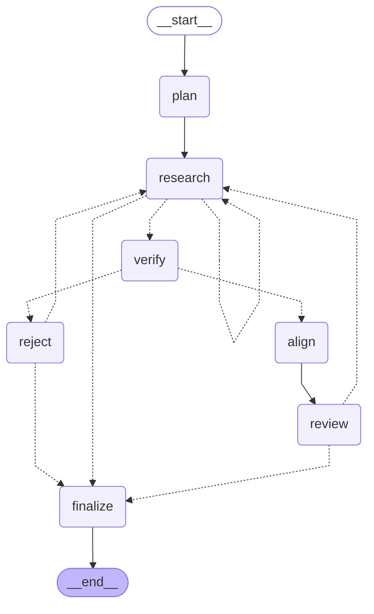

# Run report `practice-example` (run 20261109-225127)

- **Backend:** claude_cli  |  **Source:** files
- **Models:** leader=claude-opus-5-5, research=claude-haiku-5-5, research_live=claude-sonnet-5-5, verification=claude-haiku-5-5, alignment=claude-sonnet-5-5
- **Stopped because:** full-time role accepted after 3 reviews
- **Reviewed:** 3 postings in 0 search round(s); 1 rejected by code with no model calls
- **Model calls:** 15  |  **Web searches:** 0  |  **Tokens:** 712,115 in / 20,079 out  |  **Est. cost:** $0.4790

## Result

**Graduate Analyst, Electronic Rates & Market Structure (London)**, Meridian Clearing & Markets (London, UK): Full-time

Desirability 23/30, attainability 92%, rank score 25, intake: selective_programme.

> I'm accepting this role. It passes all three gates. Verification passed every check with no warnings: it was posted 2026-10-06, 5 days before the 2026-10-11 run date; it closes 2026-11-15, 35 days away; it's in London; and the September 2027 start comes after the candidate is available in July 2027, so there's no early-start penalty. It also sits squarely in a preferred lane (a multi-dealer rates venue covering market structure, pricing and API onboarding). Desirability is 23 against a threshold of 22, and the rank score is 25 after a +2 edge bonus. Attainability is 92%, backed by direct VenueCo venue experience (ADV, D2C/D2D, fee capture) and UK citizenship. The seat fits the thesis well: the junior presents to the product committee from year one and is offered a stated path to owning a product line within three years. There are three caveats. First, credibility scored only 3 because Meridian's brand is unverified. Second, intake size isn't stated, so 'selective' is inferred, not confirmed. Third, the scoring has inconsistencies to fix. The 23 is the unweighted sum; with the thesis weights it would be about 27, so the role clears the threshold either way. The crowding note also used a 2026-11-09 run date and said 6 days remained; under the 2026-10-11 run date there are 35 days to apply.

### Next steps

- **Apply:** https://careers.example.com/meridian/graduate-analyst-erates
- **Deadline:** 2026-11-15
- **Type:** Full-time (Full-time graduate programme); start 2027-09
- **Posted:** 2026-10-06 (Posting header states "Posted: 2026-10-06".)
- **Lead with:**
  - Graduating in 2027 with a strong quantitative degree (economics, finance, maths or similar) (BSc International Economics & Finance, a leading European university, graduating 2027-06, First-class equivalent; a leading European university Mathematics near-top mark; top-grade Maths (skill: quant_foundations))
  - Genuine interest in market structure, fixed income and electronic trading (VenueCo CFO Group internship (NY, 2026): US Treasury revenue forecast covering ADV, electronification, D2C/D2D share, fee capture (skill: markets_structure); a global markets bank rates/FX placement (fx_rates_markets))
  - Strong Excel; Python or SQL a plus (training provided) (Excel/VBA, Bloomberg BMC/BSA/BFF, fixed live client VBA code at VenueCo 2025 (skill: excel_vba))
  - Clear communicator, comfortable with clients (VenueCo 2025 execution-product pitch deck and product overview used with a large insurer (client_materials); VenueCo 2026 forecast presented to the Group Head of IR; tools presented to the CFO and CAO)
  - Right to work in the UK (US-UK dual citizen; home location London; no visa sponsorship needed (edge: cross_border))
- **Address in the application or interview:**
  - Responsibility: use and extend AI-assisted analytics for liquidity and execution quality (not a listed requirement, but central to the work) [partial]: There is strong applied LLM building experience, but in finance-workflow automation, not liquidity or execution-quality analytics. Python and SQL fluency are still being built, which limits how much the candidate can extend analytics in code at the start.

## Leader's search brief

- **Target roles:** Graduate / Analyst (2027 start) in market structure, product or business development at a trading venue, exchange or market-data firm (fixed income, FX or rates venues preferred), London; Electronic trading / e-commerce analyst in Markets: rates, FX or credit e-trading desks, London (2027 full-time); Markets strats / desk analyst (non-C++) in rates, FX or credit at a bank or dealer that hires small, desk-specific cohorts, London; Junior execution trader / trading analyst / trading assistant at a hedge fund or buy-side dealing desk (fixed income, FX or multi-asset), London; Portfolio analytics / risk and performance analyst at a hedge fund or multi-strategy platform, London; Junior analyst in special situations, event-driven or global macro at a hedge fund (direct-hire analyst seat, not an operations rotation), London; Commodity / power trading analyst at a utility or energy trading house (gas, power, carbon), London; Applied AI / data analyst sitting on a markets, trading or venue business (not a central IT pool), London; Secondary: the same seats in New York, only where fit is unusually close (e.g. FI venue market structure or US Treasury e-trading); Fallback only if no full-time role surfaces: 2027 off-cycle internships in the same lanes, London
- **Target employers:** VenueCo (London: EU/UK rates & credit, market structure, execution-product/automation product; leverage the internship relationship); MarketAxess (London: Open Trading, credit e-trading, data/analytics; CP+); LSEG (FX venues FXall/Matching, VenueCo parent, Data & Analytics, Post Trade/LCH SwapClear); ICE / ICE Futures Europe and ICE Data Services (London); Cboe Europe and Cboe FX (London); Euronext / MTS (London-a European city: European government bond venue; a leading European university network fit); Bloomberg (Fixed Income & FX trading solutions, product/market-structure analyst, not mass sales intake); Aquis, Turquoise, BrokerTec/CME Group London, Eurex London, TP ICAP (Liquidnet, Parameta Solutions); Virtu ITG / Liquidnet analytics, Trading Technologies, OpenGamma, Clarus Financial Technology (smaller market-structure firms); XTX Markets, Jump Trading, Optiver, Flow Traders (non-C++ trading/operations-analyst or market-structure seats only); Banks' e-trading/strats desks hiring directly or in small cohorts: Jefferies, Mizuho, Nomura, RBC Capital Markets, Natixis CIB, Société Générale, Lloyds Banking Group Markets, NatWest Markets, a global markets bank (existing placement link), Santander CIB; Hedge funds & multi-strats with London analyst or trading-assistant seats: Brevan Howard, Rokos Capital, Capula, Caxton, Lansdowne, Marshall Wace, Man Group (Man GLG, Man Numeric trading), Millennium/Balyasny/Citadel London execution & risk, Eisler Capital, Kirkoswald, Alphadyne; Event-driven / special-sits funds in London: Sona Asset Management, Polus Capital, Arini, Davidson Kempner London, Elliott London (rare analyst seats); Commodity / energy: Centrica Energy Trading, RWE Supply & Trading, Uniper, Engie GEMS, Ørsted, Statkraft, Vitol, Trafigura, Gunvor, Mercuria (selective analyst seats, not mass rotations)
- **Must-haves:** Location: London (New York only if the fit is unusually close; flag it and remember the non-home threshold is +3); Entry-level: 0 years of experience required; graduates with 2027 degrees eligible; start date on or after July 2027 (start dates earlier than ~mid-2027 incur the early-start penalty; note the date); Full-time permanent analyst/associate role first; off-cycle internships only as a labelled fallback; Seat is in a preferred lane: venue/market infrastructure/market data, Markets e-trading/strats in rates/FX/credit, buy-side trading/execution/portfolio analytics, event-driven/special-sits/macro, or selective commodity/power trading; Posting went live recently: on or after 2026-09-11 (30 days before the 2026-10-11 run date); record the posting date and the live/open status for each result; Junior makes or directly informs decisions with fast feedback (desk-facing, trading, product or PM-adjacent), not back-office processing; At least one of the candidate's edges counts directly: FI/FX market-structure knowledge, applied LLM/automation building, portfolio construction leadership, or US-UK work authorisation; Python/SQL listed as 'desirable' or 'will train', not as a hard prerequisite with a production-code expectation; Capture for each result: employer, team, title, location, posting URL, posting date, start date, closing date, cohort size if stated
- **Red flags:** Private banking, wealth management or UHNW advisory roles; Generalist PE, private credit origination, long-only benchmarked asset management research, conventional IB M&A/ECM/DCM coverage (restructuring OK), consulting or generic corporate finance/FP&A; Mass graduate programmes with large rotational intakes and no desk choice (crowding penalty -3); prefer named-desk or direct-hire seats; Roles requiring C++, a PhD, formal quant research or shipped production Python/SQL code; Roles requiring 1+ years of experience, or 'experienced hire' postings disguised as analyst roles; Postings dated before 2026-09-11, with closed applications, or evergreen/talent-pool pages with no live requisition; Start dates before July 2027 (candidate graduates June 2027); Pure operations, middle-office reconciliation, KYC processing or data-entry seats that AI is compressing (no decision rights); Sales-only seats with no market/product content, or commission-only/retail brokerage roles; Locations outside London/New York (e.g. Dublin, Paris, Amsterdam, Warsaw or Bangalore hubs for London-branded firms); Recruiter spam, unnamed 'leading hedge fund' listings without a verifiable employer, or fee-charging programmes

## Iterations

| # | Posting | Type | Posted | Verified | Wanted | Attainable | Verdict |
|---|---|---|---|---|---|---|---|
| 1 | Meridian Clearing & Markets: Graduate Analyst, Electronic Rates & Market Structure (London) | Full-time | 2026-10-06 | pass | pass | pass | ACCEPT |
| 2 | Harbourline Asset Management (fictional): Graduate Execution Analyst, Fixed Income Trading (London) | Full-time | 2026-08-28 | **FAIL** (posted_recently) | not run | not run | REJECT by code |
| 3 | Kingsbridge Bank: Global Markets Graduate Programme 2027 (London) | Full-time | 2026-10-09 | pass | **FAIL** | pass | REJECT |

### Iteration 1: Meridian Clearing & Markets, Graduate Analyst, Electronic Rates & Market Structure (London)

**Leader:** I'm accepting this role. It passes all three gates. Verification passed every check with no warnings: it was posted 2026-10-06, 5 days before the 2026-10-11 run date; it closes 2026-11-15, 35 days away; it's in London; and the September 2027 start comes after the candidate is available in July 2027, so there's no early-start penalty. It also sits squarely in a preferred lane (a multi-dealer rates venue covering market structure, pricing and API onboarding). Desirability is 23 against a threshold of 22, and the rank score is 25 after a +2 edge bonus. Attainability is 92%, backed by direct VenueCo venue experience (ADV, D2C/D2D, fee capture) and UK citizenship. The seat fits the thesis well: the junior presents to the product committee from year one and is offered a stated path to owning a product line within three years. There are three caveats. First, credibility scored only 3 because Meridian's brand is unverified. Second, intake size isn't stated, so 'selective' is inferred, not confirmed. Third, the scoring has inconsistencies to fix. The 23 is the unweighted sum; with the thesis weights it would be about 27, so the role clears the threshold either way. The crowding note also used a 2026-11-09 run date and said 6 days remained; under the 2026-10-11 run date there are 35 days to apply.

**Feedback to research:** Please make the scorer apply the thesis weights (1.5x for decision_rights and learning_density) and the 2026-10-11 run date consistently, because mismatched totals and dates make the threshold comparisons hard to trust. For the next shortlist, look for postings that state intake size, and favour employers whose brand you can show is recognised (for example, rates venues or bank e-trading desks with a known name), so that credibility and crowding are backed by evidence rather than inferred.

Desirability 23/30; attainability 92%; rank score 25; intake selective_programme.

### Iteration 2: Harbourline Asset Management (fictional), Graduate Execution Analyst, Fixed Income Trading (London)

**Code:** Rejected by code before scoring: posted_recently: posted 2026-08-28 (44 days ago; limit 7). Source: Posting states "Posted: 2026-08-28".

**Feedback to research:** Avoid roles like Harbourline Asset Management (fictional) 'Graduate Execution Analyst, Fixed Income Trading (London)', which failed posted_recently.

### Iteration 3: Kingsbridge Bank, Global Markets Graduate Programme 2027 (London)

**Leader:** The posting passes every verification check against the 2026-10-11 run date. It went up on 2026-10-09 with rolling applications, starts in September 2027 (after the candidate is available from 2027-07, so no early-start penalty), is in London (the home city) and is fully attainable (100%: likely First, UK citizen, strong markets evidence). It is still not wanted: desirability is 13 against a threshold of 22, and the rank score is 11 after the −3 crowding penalty and +1 edge bonus. Note that the dimension scores actually weight to 15, not 13, which the scorer should reconcile, but either figure is far below the bar. Bank Markets is a preferred lane, but this is the mass intake the thesis ranks lower: about 350 graduates a year across 30 countries, any discipline, with an unspecified final placement that could be sales. The posting offers no early decision rights (1/5), no ownership path (1/5) and nothing that uses the candidate's AI-builder or portfolio-leadership edges.

**Feedback to research:** Stop shortlisting broad rotational bank graduate schemes. Look instead for selective direct-entry seats: e-trading or strats analyst roles, rates or FX desks with small intakes, venue or market-data firms (VenueCo-style), and buy-side execution or portfolio-analytics roles that name technical or AI tooling and early risk or decision responsibility. Those are where the candidate's market-structure and applied-AI edges score as strong matches. Also ask the alignment agent to check that its weighted dimension total matches the desirability it reports: here 1.5×1 + 1.5×3 + 2 + 3 + 1 + 3 = 15, but it reported 13.

Desirability 13/30; attainability 100%; rank score 11; intake mass_scheme.

## Graph

Full step-by-step evidence (every check, score, adjustment and model output) is in `trace.jsonl`.
